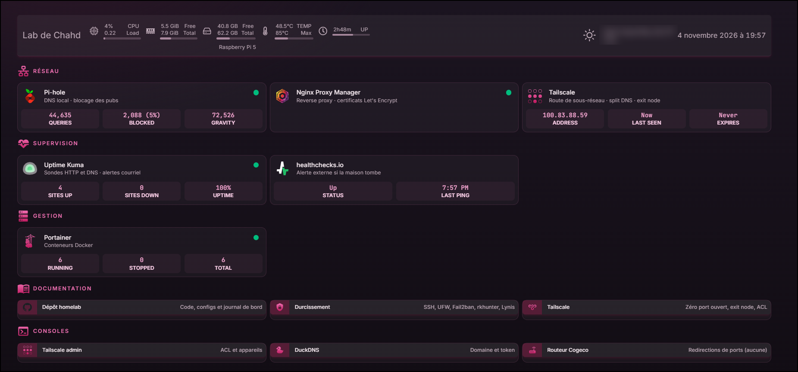
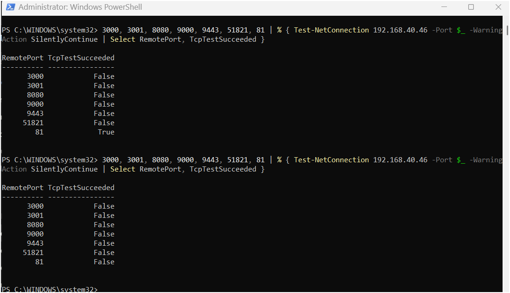

# 🌸 homelab


> **En bref**
> - **Quoi** : un lab perso sur Raspberry Pi 5, avec une dizaine de services auto-hébergés en Docker (DNS, VPN, reverse proxy HTTPS, supervision).
> - **Sécurité** : aucun port ouvert sur Internet, accès à distance par Tailscale avec des ACL au moindre privilège, Pi durci (SSH par clé, UFW, Fail2ban, Lynis 67).
> - **Preuves** : chaque mesure est vérifiée et documentée avec les commandes et des captures avant / après (`tcpdump`, `nmap`, `sshd -T`).
> - **Méthode** : un journal de bord de 14 vrais problèmes, de la cause jusqu'à la solution.



Mon lab perso sur un **Raspberry Pi 5** : DNS, VPN maillé, reverse proxy avec HTTPS, supervision, et un tableau de bord Homepage qui affiche l'état de chaque service et donne accès à tous les outils en un clic.
Le but : apprendre en construisant quelque chose d'utile, en documentant chaque problème rencontré et comment je l'ai réglé.

## Services

| Service | À quoi ça sert |
|---|---|
| **Pi-hole** | DNS local + blocage des pubs sur tout le réseau |
| **Tailscale** | VPN maillé : accès au lab de n'importe où, sans port ouvert (route de sous-réseau, split DNS, exit node, ACL) |
| **WireGuard** (wg-easy) | Ancien VPN auto-hébergé, arrêté et plus exposé depuis le passage à Tailscale |
| **DuckDNS** | Nom de domaine et défi DNS pour les certificats HTTPS |
| **Nginx Proxy Manager** | Reverse proxy + certificats HTTPS (Let's Encrypt) |
| **Uptime Kuma** | Surveille tous les services et m'alerte par courriel |
| **healthchecks.io** | Alerte externe si la maison, le Pi ou Pi-hole tombe (Kuma ne peut pas le faire lui-même) |
| **Homepage** | Page d'accueil du lab, avec l'état de chaque service |
| **Portainer** | Gestion des conteneurs Docker |

## Architecture

```
  💻 Laptop · 📱 iPhone (cégep, 5G, Wi-Fi public)
        │  Tailscale : connexion directe (NAT traversal)
        │  ou relais DERP en HTTPS si l'UDP est bloqué
        ▼
     Internet
        │
  [ Routeur ] ── aucun port redirigé ──
        │
  ┌─────┴────────────────────────────────────┐
  │  Raspberry Pi 5 (192.168.40.46)          │
  │  UFW + Fail2ban                          │
  │                                          │
  │  Tailscale (hôte, 100.83.x) .. VPN       │
  │     ├─ route vers 192.168.40.0/24        │
  │     ├─ split DNS → Pi-hole               │
  │     └─ exit node (sur demande)           │
  │                                          │
  │  Ports publiés (LAN) : 53 · 80 · 443     │
  │                                          │
  │  Pi-hole ............ DNS (:53)          │
  │  Nginx Proxy Manager  HTTPS (:443)       │
  │     │  réseau Docker « proxy »           │
  │     ├─ home.*      → homepage:3000       │
  │     ├─ pihole.*    → pihole:80           │
  │     ├─ kuma.*      → uptime-kuma:3001    │
  │     └─ portainer.* → portainer:9000      │
  │  DuckDNS ............ défi DNS (certs)   │
  │  cron → healthchecks.io (chaque minute)  │
  └──────────────────────────────────────────┘
        │
  Mes appareils à la maison
```

Chaque service a son nom en HTTPS (`https://pihole.MONDOMAINE.duckdns.org`). Pi-hole répond l'IP **locale** du Pi pour ces noms : à la maison, le trafic reste sur le LAN ; dehors, le split DNS de Tailscale envoie ces noms à Pi-hole et la route de sous-réseau amène le trafic jusqu'au Pi. NPM joint chaque service par son **nom de conteneur** : aucune interface web n'a de port publié.

## Structure du dépôt

```
homelab/
├── docker-compose.yml        # Pi-hole + Portainer
├── .env.example              # modèle pour les mots de passe
├── wireguard/                # wg-easy (+ correctif nftables), arrêté
├── duckdns/                  # mise à jour du DNS dynamique
├── proxy/                    # Nginx Proxy Manager
├── uptime-kuma/              # supervision
├── homepage/                 # page d'accueil + config 
├── configs/systeme/          # SSH, UFW, Fail2ban, rkhunter
├── docs/
│   ├── durcissement.md       # durcissement complet du Pi, pas à pas
│   ├── tailscale.md          # diagnostic WireGuard, Tailscale, zéro port ouvert
│   └── homepage.png
└── images/                   # captures avant / après
```

## Installation

```bash
git clone https://github.com/0nyxra/homelab.git
cd homelab
cp .env.example .env          # mettre ses propres mots de passe
docker volume create portainer_data
docker network create proxy   # réseau partagé entre NPM et les services
docker compose up -d          # Pi-hole + Portainer
```

Les autres services se déploient comme **stacks dans Portainer**, à partir du `docker-compose.yml` de chaque dossier (déployer wg-easy **avant** NPM et Uptime Kuma, qui rejoignent son réseau `wireguard_wg` ; la stack peut ensuite rester arrêtée). Les secrets (token DuckDNS, clé API Pi-hole, mot de passe de base de données) se définissent dans les **variables d'environnement de la stack** : ils ne sont jamais écrits dans les fichiers.

Tailscale s'installe directement sur le Pi (pas en conteneur) : voir **[docs/tailscale.md](docs/tailscale.md)**.

Remplacer `MONDOMAINE` par son sous-domaine DuckDNS, `192.168.40.46` par l'IP de son Pi, et `MAVILLE` / les coordonnées dans `homepage/config/widgets.yaml`.

## 🔒 Sécurité

- **Aucun port ouvert sur Internet.** L'ancienne redirection UDP 51820 (WireGuard) est supprimée : tout l'accès à distance passe par Tailscale. Preuve par `tcpdump` : 156 paquets avant, 0 après.
- **ACL Tailscale au moindre privilège** : SSH seulement depuis le laptop, l'iPhone n'a que le DNS et le HTTPS, et le Pi ne peut ouvrir aucune connexion vers mes appareils.
- **Aucun secret dans le dépôt** : `.env` est dans le `.gitignore`, et les stacks utilisent des variables `${...}`.
- **Vrais certificats HTTPS** sans ouvrir les ports 80/443 : défi DNS Let's Encrypt via DuckDNS.
- **SSH par clé seulement**, root interdit.
- **Pare-feu UFW** (refus par défaut, SSH limité au LAN et à Tailscale) + **Fail2ban** sur SSH.
- **Mises à jour de sécurité automatiques** (unattended-upgrades).
- **Seulement 3 ports publiés sur le Pi** (53, 80, 443, pour le LAN) au lieu de 12 : les services passent par le réseau Docker `proxy`.
- **Admin Portainer et NPM** liées à `127.0.0.1`, accessibles seulement par tunnel SSH.
- **rkhunter** : 0 rootkit. **Lynis : hardening index 67.**
- **Alerte externe** (healthchecks.io) : un ping par minute, seulement si Pi-hole répond. Si la maison tombe, je reçois quand même un courriel.
- **Exit node testé sans fuite IPv6** : sur un Wi-Fi public, tout mon trafic peut ressortir par la maison.
- Mots de passe d'application (Gmail, Pi-hole) au lieu des vrais mots de passe, tous rangés dans un gestionnaire.

➡️ Tout le détail, avec les commandes et les captures avant / après :
- **[docs/durcissement.md](docs/durcissement.md)** : SSH, UFW, Fail2ban, ports Docker, rkhunter, Lynis
- **[docs/tailscale.md](docs/tailscale.md)** : diagnostic WireGuard, Tailscale, fermeture du dernier port, exit node, ACL



## 📓 Journal de bord

Les vrais problèmes rencontrés, et comment je les ai réglés.

<details>
<summary><b>Pi-hole ignorait les requêtes du réseau</b></summary>

Depuis le Pi, tout marchait (`nslookup google.com 127.0.0.1`). Mais dès que Pi-hole devenait le DNS du réseau, mes appareils n'avaient plus Internet. La réponse était dans les logs :
```
dnsmasq: ignoring query from non-local network 192.168.40.81
```
Pi-hole tourne dans le réseau interne de Docker, alors les requêtes de mon PC arrivaient d'un réseau qu'il ne considérait pas comme « local ».

✅ `FTLCONF_dns_listeningMode: 'ALL'`, à condition de ne **jamais** ouvrir le port 53 sur le routeur.
Bonus : `WEBPASSWORD` ne fonctionne plus depuis Pi-hole v6. Remplacé par `FTLCONF_webserver_api_password`, avec le mot de passe dans le `.env`.
</details>

<details>
<summary><b>Portainer : intégration au compose et mot de passe oublié</b></summary>

Portainer tournait à part. Je l'ai intégré au docker-compose en le branchant sur son volume existant (`external: true`), pour garder mon compte.

Mot de passe oublié ? Il existe un outil officiel :
```bash
docker compose stop portainer
docker run --rm -v portainer_data:/data portainer/helper-reset-password
docker compose start portainer
```
</details>

<details>
<summary><b>Coupure de courant : diagnostic réseau</b></summary>

Plus d'Internet après une panne. Diagnostic couche par couche : `ping` vers la passerelle (OK), puis `ping 8.8.8.8` (échec). Le problème était donc la ligne du fournisseur, pas le Pi. Ensuite, pertes de paquets intermittentes : deux `ping -t` en parallèle (passerelle et Internet) pour savoir si ça venait du Wi-Fi ou de la ligne.

Leçon : un Pi en Wi-Fi qui sert de DNS rend tout le réseau dépendant du Wi-Fi. Ethernet est dans la liste.
</details>

<details>
<summary><b>WireGuard : wg0 ne démarrait pas (noyau 6.18 sans iptables legacy)</b></summary>

L'assistant de wg-easy restait bloqué, et les logs affichaient `wg show wg0 dump : No such device`. En remontant plus haut dans les logs :
```
modprobe: FATAL: Module ip_tables not found in directory /lib/modules/6.18.39+rpt-rpi-2712
iptables v1.8.13 (legacy): can't initialize iptables table `nat': Table does not exist
```
- Le module WireGuard était bien chargé (`lsmod | grep wireguard`).
- La vraie cause : wg-easy utilise **iptables legacy**, mais le noyau 6.18 de Raspberry Pi OS n'a plus que **nftables**. C'est un bug connu (issues #2627 et #2645 de wg-easy).
- 1er essai : modifier les hooks dans l'interface, mais l'enregistrement échouait.

✅ Le conteneur contient déjà `iptables-nft`. Je fais pointer `/etc/alternatives/iptables*` vers les versions `-nft` dans le `command` de la stack, donc c'est refait à chaque démarrage (voir `wireguard/docker-compose.yml`). Vérifié avec `iptables --version`, qui affiche `(nf_tables)`, et avec `wg show`.

Leçon : le premier message d'erreur n'est pas toujours la cause. Il faut remonter jusqu'à la première commande qui échoue.
</details>

<details>
<summary><b>DuckDNS : ne plus dépendre de mon IP publique</b></summary>

Mon IP publique peut changer (après une panne, par exemple), et le VPN ne marcherait plus. Un conteneur DuckDNS met mon domaine à jour toutes les 5 minutes, et wg-easy utilise le domaine au lieu de l'IP. Le token DuckDNS reste dans les variables de la stack Portainer.
</details>

<details>
<summary><b>Uptime Kuma : supervision et alertes</b></summary>

- Sondes HTTP pour les interfaces web, et une sonde **DNS** qui interroge vraiment Pi-hole : une page web qui s'affiche ne veut pas dire que le DNS répond.
- Alertes par courriel via le SMTP de Gmail, avec un **mot de passe d'application**.
- Mot de passe Kuma perdu (je l'avais écrasé avec le mot de passe d'application Gmail dans mon gestionnaire) : `docker exec -it uptime-kuma npm run reset-password`.

Leçons : une entrée par secret dans le gestionnaire, avec une note qui dit à quoi elle sert. Et si Internet tombe à la maison, aucune alerte ne peut partir.
</details>

<details>
<summary><b>Homepage : widgets, bug de voyant et thème rose 🌸</b></summary>

- Config en YAML sur le Pi, montée dans le conteneur (*bind mount*). Je modifie le fichier, et la page se met à jour.
- Widget Pi-hole avec une clé API passée par `{{HOMEPAGE_VAR_PIHOLE_KEY}}`, jamais écrite dans le fichier.
- Le voyant de Pi-hole affichait `HPE_CLOSED_CONNECTION: Data after Connection: close`. Pi-hole répondait bien `200 OK`, mais son serveur web envoie des données après avoir annoncé la fermeture de la connexion, ce que Node.js refuse. ✅ `ping` au lieu de `siteMonitor` pour Pi-hole.
- Thème : `custom.css` avec un dégradé pastel, la police Quicksand et des titres en cursive. Premier essai raté : Homepage peint son fond sur `#page_wrapper` / `#inner_wrapper` par-dessus `body`, et le thème sombre restait mémorisé dans le navigateur.
</details>

<details>
<summary><b>Reverse proxy, domaine local et HTTPS 🔒</b></summary>

1. **Premier essai avec `.lab`** : une seule ligne dans Pi-hole répond l'IP du Pi pour tous les noms en `.lab` (`address=/lab/192.168.40.46`), et Nginx Proxy Manager redirige chaque nom vers le bon service.
2. **Passage à un vrai domaine** : `.lab` n'est pas une vraie extension, donc pas de certificat HTTPS possible et certains outils (navigateurs, gestionnaires de mots de passe) le traitent mal. Maintenant : `*.MONDOMAINE.duckdns.org`, avec Pi-hole qui répond l'IP **locale** pour ce domaine.
3. **Certificat joker Let's Encrypt** obtenu par un **défi DNS** DuckDNS : aucun port à ouvrir. Clé ECDSA, renouvellement automatique.

Pièges rencontrés :
- `did not find expected key` : une erreur d'indentation YAML. `docker compose config` valide le fichier avant de lancer quoi que ce soit.
- DuckDNS ne peut poser qu'un seul enregistrement TXT à la fois : il faut demander **seulement** le joker.
- « Publicly Accessible » dans NPM veut seulement dire « sans liste d'accès ». Ce qui expose vraiment un service, c'est le routeur.
- Homepage refuse les noms inconnus : il faut les ajouter à `HOMEPAGE_ALLOWED_HOSTS`.
- Edge ouvrait les noms locaux dans mon profil du cégep (commutation automatique de profil). ✅ Une exception « Don't switch » dans `edge://settings/profiles`.
</details>

<details>
<summary><b>Durcissement SSH : ma config était ignorée</b></summary>

Après avoir mis `PasswordAuthentication no` dans `/etc/ssh/sshd_config.d/99-hardening.conf`, je pouvais **encore** me connecter par mot de passe.

- Dans OpenSSH, **la première valeur lue l'emporte**, et les fichiers de `sshd_config.d/` sont lus par ordre alphabétique.
- `50-cloud-init.conf` (créé par Raspberry Pi OS) contenait `PasswordAuthentication yes` et passait avant mon `99-`.

✅ Renommé en `01-hardening.conf`. Vérifié avec `sshd -T` (la config réellement appliquée) et un test forcé :
```
ssh -o PubkeyAuthentication=no chahd@192.168.40.46
Permission denied (publickey).
```
Leçon : vérifier ce qui est **appliqué**, pas seulement ce qui est écrit.
</details>

<details>
<summary><b>Docker passait par-dessus mon pare-feu</b></summary>

UFW activé, port 3001 non autorisé… et pourtant `Test-NetConnection 192.168.40.46 -Port 3001` répondait `True`. Docker écrit ses propres règles iptables pour les ports publiés, **avant** UFW.

✅ Un réseau Docker commun `proxy` : NPM joint chaque service par son nom (`http://uptime-kuma:3001`) et les `ports:` des interfaces web sont supprimés. Pour wg-easy, c'est NPM qui rejoint son réseau `wireguard_wg`, pour ne pas risquer de casser le NAT du VPN. Résultat : 12 ports publiés → 4.

Pièges rencontrés en chemin :
- **504 Gateway Time-out** : NPM et Kuma sur le même réseau, mais NPM pointait encore vers `192.168.40.46:3001`. La connexion repassait par le Pi et UFW la bloquait. Il faut changer la destination **tout de suite** après le réseau.
- Un `docker network connect` manuel disparaît quand le conteneur est recréé : le réseau doit être dans le compose.
- Fermer les ports a rendu Homepage et Kuma tout gris : ils surveillaient encore `IP:port`. Passés aux noms de conteneurs.
- Tous mes sites en timeout, sauf en navigation privée : cache DNS d'Edge après le redémarrage de Pi-hole (`edge://net-internals/#dns`).

Détails et captures : [docs/durcissement.md](docs/durcissement.md)
</details>

<details>
<summary><b>WireGuard ne marchait pas en 5G… mais le serveur allait bien</b></summary>

Au cégep, mon cell envoyait des paquets WireGuard vers la maison sans jamais recevoir de réponse. Le soir, `tcpdump -ni wlan0 udp port 51820` sur le Pi :
- 1er essai : tout marchait… parce que le cell était encore sur le Wi-Fi de la maison (*hairpin NAT*, l'adresse source était ma propre IP publique) ;
- 2e essai en LTE : ✅ tunnel établi et vrai transfert de données ;
- en 5G : ❌. Mon fournisseur y passe par un réseau IPv6 seulement avec **NAT64**, et l'UDP de WireGuard ne revient pas.

Leçon : un test « ça marche » ne vaut que si on sait **par où** passe le trafic.
</details>

<details>
<summary><b>Tailscale : « ça marche sur mon ordi » n'est pas un test</b></summary>

- Mon premier test « extérieur » était sur le Wi-Fi de la maison : `netcheck` affichait `self=192.168.40.30`.
- `ping 100.83.88.59` marchait, mais pas `ping 192.168.40.46` : la route de sous-réseau était **annoncée** mais pas **approuvée** dans la console.
- Le split DNS n'avait jamais été ajouté : le DNS du partage de connexion répondait mon IP publique.
- `nslookup` répondait encore la mauvaise IP après la correction : sur Windows, il **ignore la NRPT** où Tailscale range son split DNS. ✅ `Resolve-DnsName` et `Get-DnsClientNrptRule`.
- Sur iPhone, un seul VPN à la fois : WireGuard actif bloquait Tailscale.

Détails : [docs/tailscale.md](docs/tailscale.md)
</details>

<details>
<summary><b>Fermer le dernier port sans me couper l'accès</b></summary>

- La règle UFW `tailscale0` **n'existait pas**. Le ping, Kuma (Docker contourne UFW) et le DNS marchaient quand même, ce qui masquait le problème : fermer WireGuard m'aurait coupé le SSH à distance. ✅ Ajoutée, puis SSH testé par Tailscale **avant** de fermer quoi que ce soit.
- Après l'ajout, la règle n° 7 n'était plus WireGuard mais Tailscale : un `ufw delete 7` l'aurait supprimée. ✅ `ufw delete allow 51820/udp`, par contenu.
- La règle UFW 51820 n'avait jamais vraiment protégé le port (encore Docker) : ce qui ferme la porte, c'est la redirection du routeur.
- `nmap -sU` répond `open|filtered` avant **et** après : WireGuard ne répond jamais aux inconnus. La vraie preuve, c'est `tcpdump`.
</details>

<details>
<summary><b>Un port FTP « ouvert » sur mon laptop… qui n'était pas mon laptop</b></summary>

Un scan de l'IP Tailscale de mon laptop montrait `21/tcp open`, mais `netstat` ne voyait aucun service. `Test-NetConnection` a donné la réponse : Tailscale coupé, la connexion sortait par le **Wi-Fi** vers le réseau du fournisseur.

Tailscale et les fournisseurs cellulaires utilisent la **même plage 100.64.0.0/10 (CGNAT)**. Sans Tailscale, l'adresse ne m'appartenait plus et je scannais un équipement du fournisseur. Avec Tailscale actif : port fermé.

Leçon : une IP n'identifie une machine que dans un réseau donné. Toujours vérifier l'interface utilisée.
</details>

## Ce que ce projet m'a appris

**Réseau** : DNS, NAT et redirection de ports, VPN WireGuard et Tailscale (route de sous-réseau, split DNS, exit node, NAT traversal, relais DERP), NAT64 et CGNAT, DNS dynamique, réseaux Docker, diagnostic couche par couche (`ping`, `nslookup`, `Resolve-DnsName`, `tracert`, `tcpdump`, `nmap`, `Test-NetConnection`)
**Sécurité** : surface d'attaque minimale (zéro port ouvert), moindre privilège (ACL), tests négatifs et de fuite IPv6, durcissement Linux (SSH, UFW, Fail2ban, rkhunter, Lynis), gestion des secrets, certificats TLS et défi DNS, mots de passe d'application
**Linux et Docker** : Docker Compose, volumes et *bind mounts*, variables d'environnement, lecture de logs, iptables et nftables
**Supervision** : sondes HTTP et DNS, alertes SMTP, *dead man's switch* externe
**Méthode** : lire les logs jusqu'à la vraie cause, garder un accès de secours avant de toucher au pare-feu, vérifier un résultat par une deuxième méthode, tout documenter

## Prochaines étapes

- [x] Pi-hole pour tout le réseau
- [x] Portainer dans le docker-compose
- [x] WireGuard testé depuis l'extérieur
- [x] DNS dynamique (DuckDNS)
- [x] Supervision + alertes (Uptime Kuma)
- [x] Page d'accueil avec widgets (Homepage)
- [x] Reverse proxy + vrai HTTPS
- [x] Durcissement du Pi (SSH, UFW, Fail2ban, ports Docker, rkhunter, Lynis)
- [x] Tailscale (route de sous-réseau, split DNS) et **zéro port ouvert**
- [x] Alerte externe (healthchecks.io)
- [x] Exit node + ACL au moindre privilège
- [x] Test Tailscale depuis le Wi-Fi du cégep
- [ ] iTop (billetterie / gestion de services)
- [ ] Grafana + Prometheus
- [ ] Sauvegarde automatique des configs et des volumes


---
*Projet en évolution constante. Si ça casse, c'est que j'apprends.* 🔧
