# 🔒 Durcissement du Raspberry Pi

Ce document décrit la sécurisation de mon homelab (Raspberry Pi 5, Raspberry Pi OS / Debian 13 « trixie ») : accès SSH, pare-feu, protection contre la force brute, mises à jour, exposition des services Docker et audit final.

## Résumé

| Mesure | Outil | Résultat |
|---|---|---|
| Accès SSH par clé seulement | OpenSSH | Mots de passe refusés |
| Pare-feu | UFW | Tout est refusé par défaut, SSH limité au LAN et au VPN |
| Protection force brute | Fail2ban | Jail `sshd` active (journal systemd) |
| Mises à jour de sécurité | unattended-upgrades | Installation automatique quotidienne |
| Exposition des services Docker | Réseau Docker `proxy` + NPM | 4 ports exposés au lieu de 12 |
| Interfaces d'administration | Tunnel SSH | Portainer et NPM admin liés à `127.0.0.1` |
| Détection de rootkits | rkhunter | 0 rootkit détecté |
| Audit | Lynis | **Hardening index : 67** |

Accès depuis Internet : **seul le port 51820/UDP (WireGuard) est redirigé** sur le routeur. Tous les services ne sont joignables à distance que par le VPN.

---

## 1. SSH : authentification par clé seulement

Clé générée sur le poste Windows :

```powershell
ssh-keygen -t ed25519 -C "chahd-laptop"
type $env:USERPROFILE\.ssh\id_ed25519.pub | ssh chahd@<IP_DU_PI> "mkdir -p ~/.ssh && chmod 700 ~/.ssh && cat >> ~/.ssh/authorized_keys && chmod 600 ~/.ssh/authorized_keys"
```

Configuration dans `/etc/ssh/sshd_config.d/01-hardening.conf` :

```
PermitRootLogin no
PasswordAuthentication no
KbdInteractiveAuthentication no
PubkeyAuthentication yes
MaxAuthTries 3
AllowUsers chahd
X11Forwarding no
```

Vérification :

```bash
sudo sshd -t && sudo systemctl restart ssh
sudo sshd -T | grep -i passwordauth    # passwordauthentication no
```

```powershell
ssh -o PubkeyAuthentication=no chahd@<IP_DU_PI>
# chahd@<IP_DU_PI>: Permission denied (publickey).
```

**Résultat : connexion par mot de passe refusée**

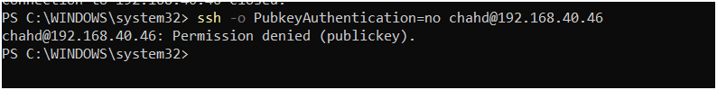

> ⚠️ **Piège rencontré :** mon fichier s'appelait d'abord `99-hardening.conf` et les mots de passe fonctionnaient encore. Dans OpenSSH, **la première valeur lue l'emporte**, et les fichiers de `sshd_config.d/` sont lus par ordre alphabétique. Le fichier `50-cloud-init.conf` (créé par Raspberry Pi OS) contenait `PasswordAuthentication yes` et passait avant le mien. Solution : renommer mon fichier en `01-hardening.conf`.

---

## 2. Pare-feu UFW

```bash
sudo ufw default deny incoming
sudo ufw default allow outgoing
sudo ufw allow from 192.168.40.0/24 to any port 22 proto tcp comment 'SSH LAN'
sudo ufw allow from 10.8.0.0/24     to any port 22 proto tcp comment 'SSH VPN'
sudo ufw allow from 10.42.42.0/24   to any port 22 proto tcp comment 'SSH via wg-easy'
sudo ufw allow 51820/udp comment 'WireGuard'
sudo ufw allow from 192.168.40.0/24 to any port 53 comment 'DNS Pi-hole'
sudo ufw allow from 192.168.40.0/24 to any port 80,443 proto tcp comment 'Reverse proxy'
sudo ufw enable
```

**Règles UFW actives**

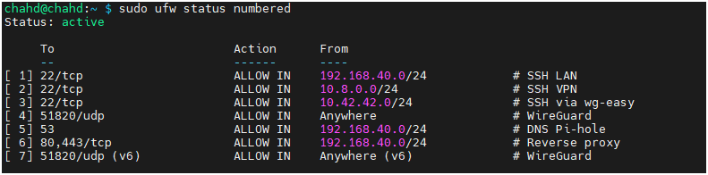

Le réseau `10.42.42.0/24` est celui du conteneur wg-easy : un client VPN qui se connecte en SSH arrive sur le Pi avec l'adresse du conteneur (NAT), et non avec son adresse VPN `10.8.0.x`.

L'adresse du Pi est aussi réservée dans le DHCP du routeur, pour que Pi-hole, les règles UFW et la redirection WireGuard ne cassent pas si l'IP change.

---

## 3. Fail2ban

`/etc/fail2ban/jail.local` :

```ini
[DEFAULT]
bantime = 1h
findtime = 10m
maxretry = 5
ignoreip = 127.0.0.1/8 ::1 192.168.40.0/24 10.8.0.0/24 10.42.42.0/24

[sshd]
enabled = true
backend = systemd
```

```bash
sudo fail2ban-client status sshd
```

**Jail `sshd` active, branchée sur le journal systemd**

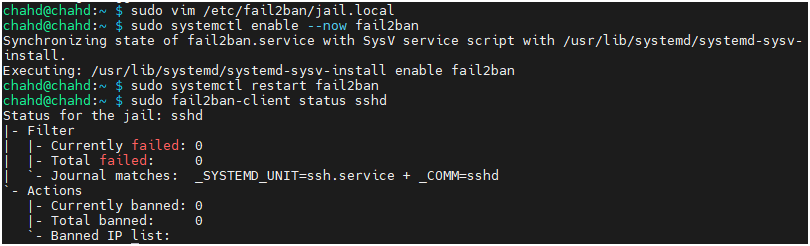

---

## 4. Mises à jour automatiques

```bash
sudo apt install unattended-upgrades apt-listchanges -y
sudo dpkg-reconfigure -plow unattended-upgrades
sudo unattended-upgrade --dry-run --debug
```

Pas de redémarrage automatique : le Pi fait le DNS du réseau, je choisis le moment des redémarrages.

**Configuration active et test à blanc**

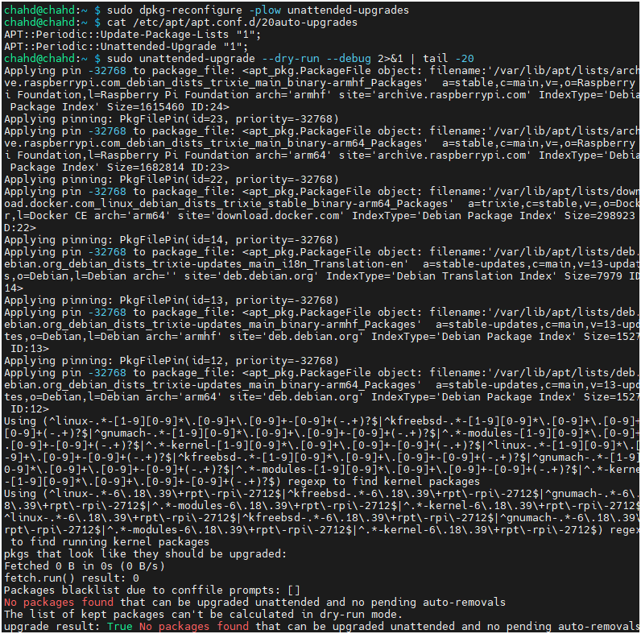

---

## 5. Docker contourne UFW

**Constat :** Docker écrit ses propres règles iptables pour les ports publiés (`ports:` dans un compose). Ces règles passent **avant** UFW.

```powershell
Test-NetConnection <IP_DU_PI> -Port 3001
# TcpTestSucceeded : True   ← alors qu'aucune règle UFW n'autorise le 3001
```

**Avant : chaque service publie ses ports sur `0.0.0.0`**

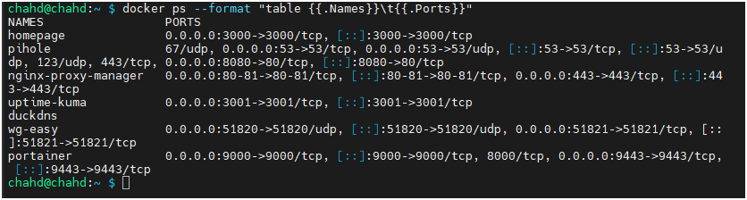

**Solution :** ne plus publier les ports des services web. Tous les services rejoignent un réseau Docker commun, et Nginx Proxy Manager les joint par leur **nom de conteneur**.

```bash
docker network create proxy
```

Dans chaque stack :

```yaml
services:
  mon-service:
    networks:
      - default
      - proxy

networks:
  proxy:
    external: true
```

```
                 Internet
                    │  51820/udp seulement
              ┌─────▼──────┐
              │  Routeur   │
              └─────┬──────┘
          LAN       │
   ┌────────────────▼───────────────────────────────┐
   │ Raspberry Pi   UFW                             │
   │                                                │
   │  :53 Pi-hole   :80/:443 NPM   :51820 wg-easy   │
   │                     │                          │
   │        ┌────────────┴─ réseau « proxy » ──┐    │
   │        │ homepage:3000   uptime-kuma:3001 │    │
   │        │ pihole:80       portainer:9000   │    │
   │        └──────────────────────────────────┘    │
   │   NPM ── réseau « wireguard_wg » ── wg-easy:51821
   └────────────────────────────────────────────────┘
```

Pour wg-easy, c'est NPM (et Uptime Kuma) qui rejoignent le réseau `wireguard_wg`, plutôt que d'ajouter un réseau à wg-easy : changer ses interfaces risquait de casser le NAT des clients VPN.

### Ports publiés : avant / après

| Service | Avant | Après |
|---|---|---|
| Pi-hole | 53, 8080 | **53** |
| Nginx Proxy Manager | 80, 81, 443 | **80, 443**, `127.0.0.1:81` |
| wg-easy | 51820/udp, 51821 | **51820/udp** |
| Homepage | 3000 | — |
| Uptime Kuma | 3001 | — |
| Portainer | 9000, 9443 | `127.0.0.1:9000` |

**Après : seuls 53, 80, 443 et 51820/udp restent publiés** (et la règle UFW temporaire a été retirée)

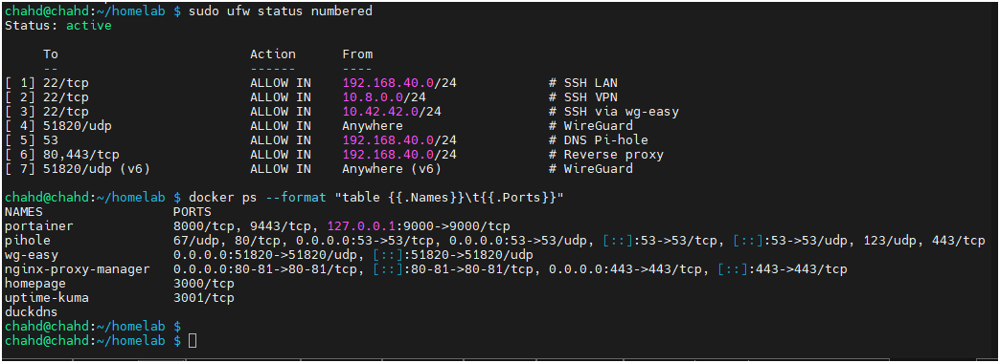

### Nginx Proxy Manager : avant / après

**Avant : les destinations passent par l'IP du Pi et les ports publiés**

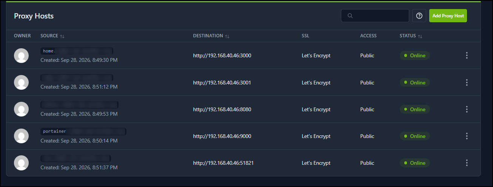

**Après : les destinations utilisent les noms de conteneurs**

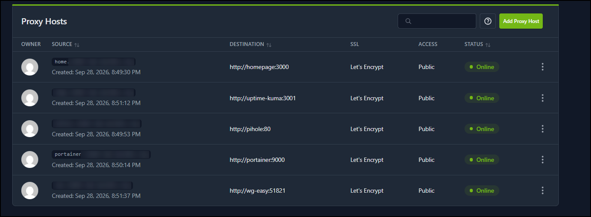

Test final depuis le LAN :

```powershell
3000, 3001, 8080, 9000, 9443, 51821, 81 | % {
  Test-NetConnection <IP_DU_PI> -Port $_ -WarningAction SilentlyContinue |
  Select RemotePort, TcpTestSucceeded }
# Tous : False
```

**Avant / après sur le port 81 (admin NPM) : `True` puis `False`**

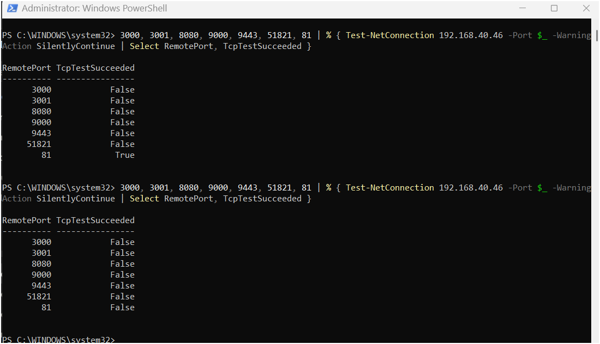

### Homepage et Uptime Kuma

Fermer les ports a rendu les pastilles de Homepage et les moniteurs Kuma « down » : ils surveillaient encore `IP:port`.

**Symptôme : pastilles grises, stats Pi-hole vides**

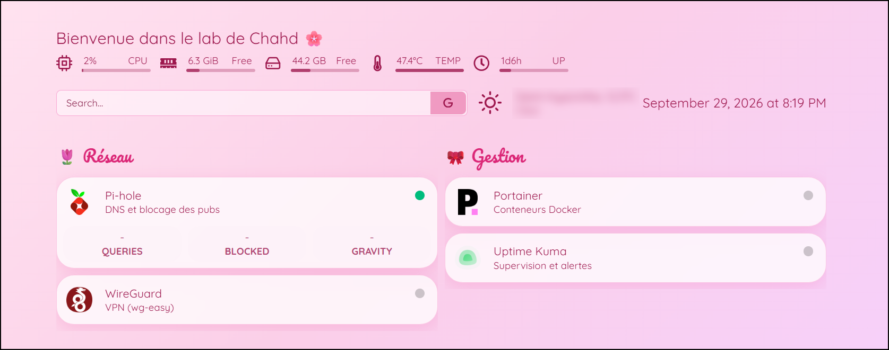

**Avant : `services.yaml` pointe vers `192.168.40.46:port`**

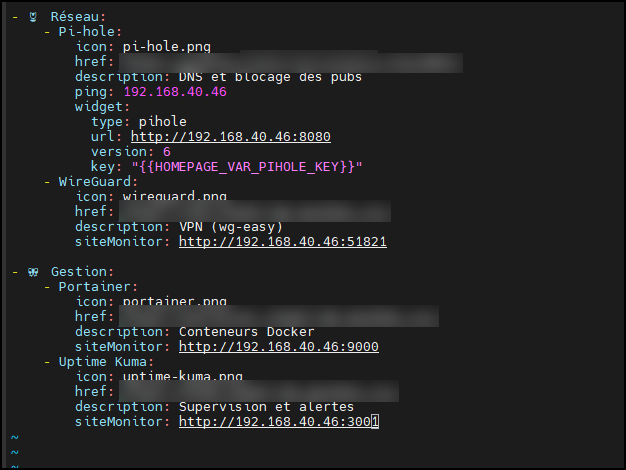

**Après : remplacement par les noms de conteneurs**

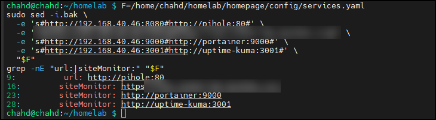

Les moniteurs Uptime Kuma ont été modifiés de la même façon (`http://portainer:9000`, `http://pihole:80/admin/`, `http://wg-easy:51821`…). Kuma a aussi rejoint le réseau `wireguard_wg` pour surveiller wg-easy.

---

## 6. Interfaces d'administration par tunnel SSH

Portainer et l'admin de NPM ne sont plus joignables depuis le réseau. Accès de secours si le reverse proxy tombe :

```powershell
ssh -L 8081:localhost:81   chahd@<IP_DU_PI>   # NPM   → http://localhost:8081
ssh -L 9000:localhost:9000 chahd@<IP_DU_PI>   # Portainer → http://localhost:9000
```

**Admin NPM ouverte par le tunnel SSH (`localhost:8081`)**

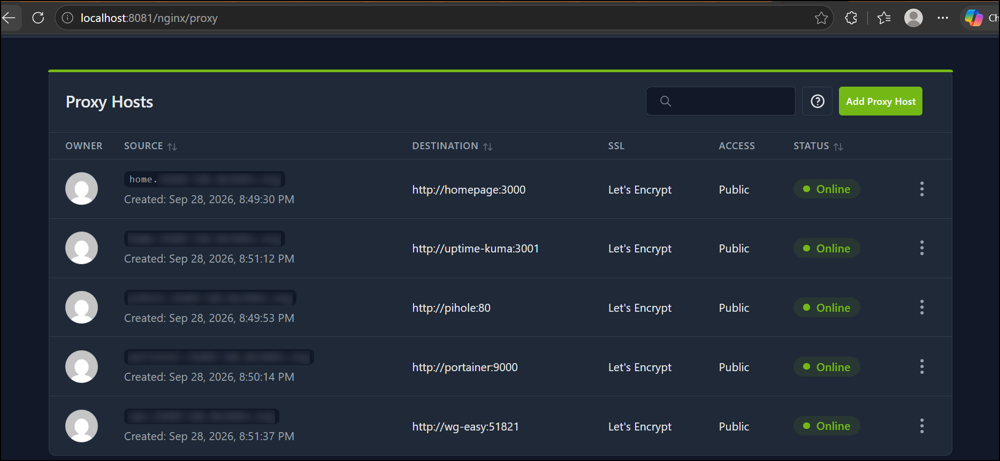

---

## 7. rkhunter

```bash
sudo apt install rkhunter -y
sudo rkhunter --propupd
sudo rkhunter --check --sk
```

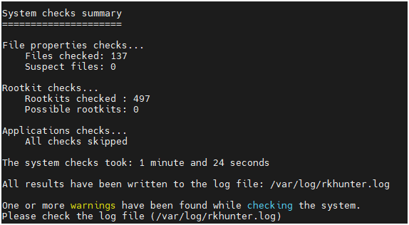

Résultat : **0 rootkit**, 3 avertissements analysés, tous des faux positifs :

| Avertissement | Explication | Action |
|---|---|---|
| `PermitRootLogin has not been set` | rkhunter lit seulement `/etc/ssh/sshd_config` et ignore `sshd_config.d/` | Ligne ajoutée aussi dans le fichier principal |
| `Hidden file: /etc/.updated` | Fichier normal créé par systemd | `ALLOWHIDDENFILE` |
| Fichiers suspects dans `/dev` | Mémoire partagée (`/dev/shm`) | `ALLOWDEVFILE` |

---

## 8. Audit Lynis

```bash
sudo lynis audit system
```

**Hardening index : 67** — pare-feu et scanner de malware détectés.

---

## Pièges rencontrés

- **`sshd_config.d` et l'ordre de lecture** : voir section 1.
- **504 Gateway Time-out** : en mettant NPM et Uptime Kuma sur le même réseau alors que NPM pointait encore vers `IP_DU_PI:3001`, Docker ne faisait plus la redirection directe ; la connexion passait par le Pi et UFW la bloquait. Solution : pointer NPM vers le nom du conteneur **immédiatement** après avoir changé le réseau.
- **Conteneur recréé = réseau perdu** : un `docker network connect` manuel disparaît quand le conteneur est recréé. Le réseau doit être déclaré dans le compose.
- **Moniteurs et tableau de bord** : fermer les ports a rendu Homepage et Uptime Kuma « down » ; ils utilisaient encore `IP:port`.
- **Cache DNS du navigateur** : après un redémarrage de Pi-hole, Edge a gardé une mauvaise résolution (le site marchait en navigation privée). Le DNS-over-HTTPS du navigateur peut aussi contourner Pi-hole.

## Prochaines étapes

- Sauvegardes automatiques des stacks et volumes
- Supervision avancée (Prometheus + Grafana)
- Gestionnaire de mots de passe auto-hébergé (Vaultwarden)
