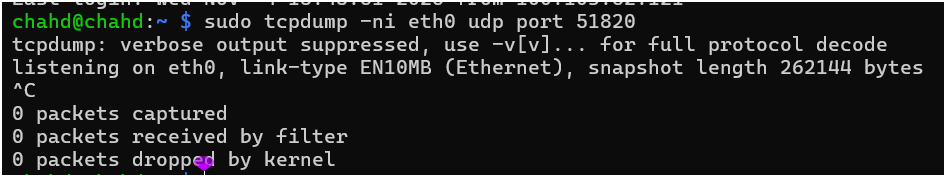
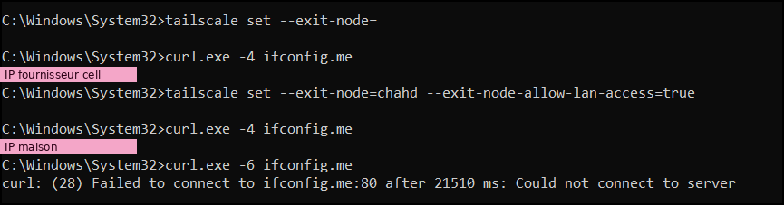
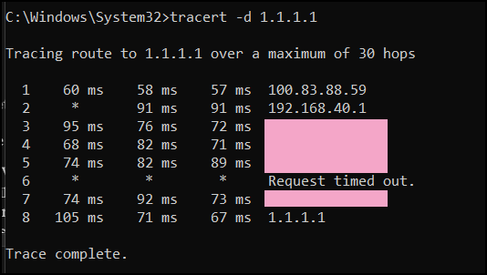
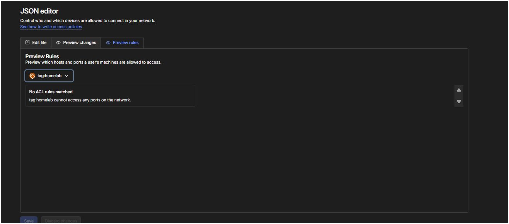

# 🔐 Accès à distance : diagnostic WireGuard et ajout de Tailscale

> **Date :** 4 novembre 2026
> **Objectif :** accéder aux services du lab (Uptime Kuma, Homepage, Pi-hole…) depuis le cégep et le réseau cellulaire, puis fermer le dernier port ouvert sur Internet.

> 🔒 Les adresses IP publiques sont masquées (`<IP_PUBLIQUE_MAISON>`, `<IP_CELL>`).

---

## 1. Contexte

Mes services ne sont pas exposés sur Internet : depuis le [durcissement](durcissement.md), le seul port redirigé sur le routeur était **51820/udp** (WireGuard, via wg-easy). À la fin de cette session, il n'y en a plus aucun. Pour joindre Kuma de l'extérieur, il faut donc un tunnel VPN.

Le 4 novembre au matin, au cégep, **le tunnel WireGuard de mon cell ne se connectait pas** : le client envoyait des paquets vers mon IP publique, mais ne recevait jamais de réponse de *handshake*. Le cell était en **5G**, et son journal mentionnait **DNS64**. Le client WireGuard n'existait aussi que sur mon cell, pas sur mon laptop.

Deux objectifs pour la soirée :
1. Comprendre pourquoi WireGuard ne répondait pas.
2. Ajouter **Tailscale** comme accès plus robuste, qui fonctionne même quand l'UDP est bloqué.

---

## 2. Diagnostic WireGuard

### 2.1 Le serveur tourne-t-il ? L'IP est-elle à jour ?

```bash
docker ps --format "table {{.Names}}\t{{.Status}}" | grep -E "wg-easy|duckdns"
# wg-easy   Up 21 hours (healthy)
# duckdns   Up 21 hours

curl -s ifconfig.me                       # IP publique réelle
nslookup chahd-lab.duckdns.org 1.1.1.1    # IP annoncée par DuckDNS
```

✅ Les deux conteneurs tournaient depuis la veille (donc aussi ce matin), et l'IP DuckDNS correspondait à l'IP publique réelle.

### 2.2 Les paquets arrivent-ils jusqu'au Pi ?

```bash
sudo apt install tcpdump
sudo tcpdump -ni wlan0 udp port 51820
```

**1er essai : un faux positif (hairpin NAT)**

```
<IP_PUBLIQUE_MAISON>.58721 > 192.168.40.46.51820: UDP, length 148   ← handshake initiation
192.168.40.46.51820 > <IP_PUBLIQUE_MAISON>.58721: UDP, length 92    ← handshake response
```

Le tunnel s'établit, mais **l'adresse source est ma propre IP publique** : le cell était encore sur le Wi-Fi de la maison. Le trafic sortait vers l'IP publique et le routeur le renvoyait vers le Pi (*hairpin NAT* / *NAT loopback*).

Ce test prouve quand même trois choses : wg-easy répond, UFW laisse passer, et la redirection du port 51820 existe (sinon le hairpin ne marcherait pas).

**2e essai : cell en LTE, Wi-Fi coupé**

```
192.168.40.46.51820 > <IP_CELL>.44027: UDP, length 1440   (× des centaines)
<IP_CELL>.44027 > 192.168.40.46.51820: UDP, length 96     (× des centaines)
```

✅ Source = réseau cellulaire. On voit un vrai transfert : le Pi envoie des paquets de 1440 octets (données chiffrées), le cell répond par des paquets de 96 octets (accusés de réception TCP, chiffrés dans le tunnel).

### 2.3 Conclusion

| Réseau du cell | WireGuard |
|---|---|
| Wi-Fi maison (hairpin) | ✅ |
| LTE | ✅ |
| 5G (DNS64 / NAT64) | ❌ ce matin, et de nouveau au 1er essai du test 2 |

Le serveur n'était pas en cause. En 5G, mon fournisseur passe par un réseau **IPv6 seulement avec traduction NAT64**, et le trafic UDP de WireGuard ne revient pas. En LTE, le cell a une vraie IPv4 et tout passe.

> 💡 **Leçon :** un test « ça marche » n'est valable que si on sait **par où** passe le trafic. La première capture semblait parfaite, mais elle ne testait pas l'accès de l'extérieur.

---

## 3. Pourquoi Tailscale ?

| | WireGuard (wg-easy) | Tailscale |
|---|---|---|
| Port ouvert sur le routeur | 51820/udp | **aucun** |
| Si l'UDP est bloqué (5G NAT64, pare-feu) | ❌ | ✅ relais **DERP** en HTTPS (443) |
| Connexion | client → serveur | maillage (*mesh*), connexion directe quand c'est possible |
| Gestion des clés | manuelle (un profil par appareil) | automatique, via le compte |
| Hébergement | 100 % chez moi | serveur de coordination chez Tailscale |

Les deux cohabitent : je garde wg-easy pour l'instant.

---

## 4. Installation sur le Pi

Installé directement sur l'hôte (pas en conteneur), pour simplifier le routage. Dans `tmux`, au cas où la connexion SSH coupe.

```bash
curl -fsSL https://tailscale.com/install.sh | sh

# Le routage de sous-réseau a besoin de l'IP forwarding
echo 'net.ipv4.ip_forward = 1' | sudo tee /etc/sysctl.d/99-tailscale.conf
sudo sysctl -p /etc/sysctl.d/99-tailscale.conf

# Le Pi annonce le réseau de la maison ; Tailscale ne touche pas au DNS du Pi (Pi-hole tourne dessus)
sudo tailscale up --advertise-routes=192.168.40.0/24 --accept-dns=false

# Le noyau 6.18 n'a plus iptables legacy (même problème qu'avec wg-easy) → forcer nftables
echo 'TS_DEBUG_FIREWALL_MODE=nftables' | sudo tee -a /etc/default/tailscaled
sudo systemctl restart tailscaled

# UFW : autoriser ce qui arrive par le tunnel
sudo ufw allow in on tailscale0
```

| Appareil | Nom Tailscale | IP Tailscale |
|---|---|---|
| Raspberry Pi | `chahd` | `100.83.88.59` |
| Laptop | `msi` | `100.103.52.121` |
| iPhone | `iphone-15-plus` | `100.115.75.17` |

> ⚠️ Avertissement affiché : `UDP GRO forwarding is suboptimally configured on wlan0`. Il concerne seulement le débit en Wi-Fi ; à revoir quand le Pi passera en Ethernet.

---

## 5. Configuration de la console Tailscale

1. **Route de sous-réseau** : *Machines → chahd → Edit route settings* → cocher `192.168.40.0/24`.
2. **Expiration de la clé désactivée** sur le Pi (*Disable key expiry*), sinon il décroche tout seul après quelques mois.
3. **Split DNS** : *DNS → Add nameserver → Custom* → `100.83.88.59`, **Restrict to domain** = `chahd-lab.duckdns.org`.
   Seuls les noms du lab passent par Pi-hole ; le reste de la navigation garde le DNS normal du réseau.

> 💡 J'ai mis l'IP **Tailscale** de Pi-hole (`100.83.88.59`), pas son IP locale (`192.168.40.46`) : ainsi le DNS fonctionne même si la route de sous-réseau tombe, et une panne de route ne casse pas deux choses à la fois.

---

## 6. Comment une requête arrive jusqu'à Kuma

Pour ouvrir `https://kuma.chahd-lab.duckdns.org`, l'appareil doit répondre à trois questions :

1. **Où est-ce ? (DNS)** Pi-hole répond `192.168.40.46` ; tout autre DNS sur Internet répond mon IP publique (via DuckDNS).
2. **Comment y aller ? (chemin réseau)** `192.168.40.46` est une adresse privée : de l'extérieur, il faut le tunnel et la route de sous-réseau.
3. **Qui ouvre la porte ? (NPM)** Nginx Proxy Manager lit le nom demandé et envoie vers le conteneur `uptime-kuma:3001`.

Chemin complet sur Windows avec Tailscale :

```
Navigateur → NRPT Windows → 100.100.100.100 (Tailscale) → Pi-hole (100.83.88.59)
          → 192.168.40.46 → route de sous-réseau via le Pi → NPM → uptime-kuma:3001
```

| Où je suis | Qui répond au DNS | Chemin vers 192.168.40.46 | Résultat |
|---|---|---|---|
| Maison | Pi-hole (DHCP) | direct sur le LAN | ✅ |
| Dehors + WireGuard | Pi-hole (profil wg-easy) | tunnel WireGuard | ✅ (sauf 5G) |
| Dehors + Tailscale **sans** split DNS | DNS du réseau → IP publique | — | ❌ |
| Dehors + Tailscale **avec** split DNS | Pi-hole via `100.83.88.59` | route de sous-réseau | ✅ |

> 💡 **Le tunnel ne règle que la question 2.** Si la réponse DNS est fausse, le tunnel ne sert à rien.

---

## 7. Tests

Tous les tests « extérieurs » sont faits **sans le Wi-Fi de la maison** et **avec WireGuard coupé**.

| # | Test | Réseau | Résultat |
|---|---|---|---|
| 1 | Laptop → ping, DNS, Kuma | Partage de connexion du cell | ✅ (après correction de la route et du split DNS) |
| 2 | iPhone → Kuma | 5G | ✅ avec Tailscale, ❌ avec WireGuard |
| 3 | Laptop, **Tailscale coupé** | Partage de connexion du cell | ✅ échoue comme prévu |
| 4 | Laptop → Kuma | Wi-Fi du cégep (UDP bloqué) | ✅ via le relais DERP (TCP 443) |

### Test 1 : laptop sur le partage de connexion

```powershell
tailscale status
tailscale ping 100.83.88.59
ping 192.168.40.46
Resolve-DnsName kuma.chahd-lab.duckdns.org
(Get-DnsClientNrptRule).Namespace | Select-String "chahd"
```

- `tailscale ping` : d'abord `via DERP(tor)` (relais de Toronto), puis connexion directe → démonstration du *NAT traversal*.
- `Resolve-DnsName` → `192.168.40.46`, **TTL 0** (réponse servie par le résolveur de Tailscale).
- NRPT → règle `.chahd-lab.duckdns.org` vers `100.100.100.100`.

### Test 3 : test négatif (avant / après)

| | Tailscale coupé | Tailscale actif |
|---|---|---|
| `Resolve-DnsName kuma…` | IP publique (DuckDNS, TTL 77) | `192.168.40.46` (Pi-hole, TTL 0) |
| `ping 192.168.40.46` | ❌ délai dépassé | ✅ 84–105 ms |

✅ Sans tunnel, les services sont injoignables.

---

### Test 4 : Wi-Fi du cégep (réseau restrictif)

- UDP bloqué, donc aucune connexion directe possible.
- Tailscale bascule automatiquement sur le relais DERP Toronto (TCP 443), avec une latence de 26 à 41 ms.
- Le DNS résout `kuma.chahd-lab.duckdns.org` vers `192.168.40.46` et le tableau de bord Uptime Kuma est accessible.

✅ Le lab reste joignable même derrière un pare-feu qui bloque l'UDP.


## 8. Pièges rencontrés 🪤

<details>
<summary><b>« Ça marche » sur le Wi-Fi de la maison… ce n'est pas un test</b></summary>

Mon premier test 1 a été fait par erreur sur le Wi-Fi de la maison. Indices dans les sorties :
- `tailscale netcheck` : `self=192.168.40.30`, `gw=192.168.40.1` → réseau local ;
- `tailscale ping` : direct via `192.168.40.46:41641` en 7 ms → connexion locale ;
- `nslookup` : `Server: 192.168.40.46` → Pi-hole reçu par DHCP, pas le DNS de Tailscale.

**Leçon :** toujours vérifier son IP (`ipconfig`) avant un test « extérieur ».
</details>

<details>
<summary><b>La route de sous-réseau n'était pas approuvée</b></summary>

Sur le partage de connexion : `ping 100.83.88.59` (le Pi par son IP Tailscale) marchait, mais `ping 192.168.40.46` échouait.
Le tunnel était donc correct ; seule la route manquait. Dans la console, la case `192.168.40.0/24` n'était pas cochée : `--advertise-routes` **annonce** la route, mais il faut aussi l'**approuver**.
</details>

<details>
<summary><b>Le split DNS n'avait jamais été ajouté</b></summary>

La page DNS de la console ne montrait que MagicDNS et *Local DNS settings*. Sans serveur personnalisé, le laptop demandait `kuma.chahd-lab.duckdns.org` au DNS du partage de connexion, qui répondait mon IP publique.

`nslookup kuma… 100.83.88.59` répondait bien `192.168.40.46` : Pi-hole acceptait les requêtes venant de Tailscale, il ne fallait donc **pas** activer *Permit all origins*.
</details>

<details>
<summary><b><code>nslookup</code> ignore le split DNS de Windows</b></summary>

Même après l'ajout du split DNS, `nslookup` répondait encore l'IP publique, avec `Server: 172.20.10.1` (le DNS du partage).

Sur Windows, Tailscale applique le split DNS avec la **NRPT** (*Name Resolution Policy Table*). `nslookup` l'ignore et interroge toujours le DNS de la carte principale. `ping`, les navigateurs et `Resolve-DnsName` passent par le résolveur de Windows, qui respecte la NRPT.

**Leçon :** sur Windows, tester avec `Resolve-DnsName`, et vérifier la règle avec `Get-DnsClientNrptRule`.
</details>

<details>
<summary><b>iPhone : un seul VPN à la fois</b></summary>

Mon premier test 2 a échoué parce que WireGuard était encore actif : sur iPhone, activer un VPN coupe l'autre. Je testais donc WireGuard en 5G, ce qui a confirmé le problème NAT64. Avec WireGuard désactivé et Tailscale actif, Kuma charge en 5G.
</details>

---

## 9. Durcissement après Tailscale

### 9.1 Fermeture de 51820/udp : zéro port ouvert sur Internet

**Prérequis :** SSH confirmé par Tailscale depuis l'extérieur (partage de connexion).

> ⚠️ **Piège : la règle UFW pour Tailscale n'existait pas.** `ufw status numbered` ne montrait aucune ligne `tailscale0`. Le ping (autorisé par défaut), Kuma (Docker contourne UFW) et le DNS (port 53 ouvert) marchaient quand même, ce qui masquait le problème. Mais le SSH par Tailscale aurait été bloqué : fermer WireGuard m'aurait coupé l'accès SSH à distance.

```bash
sudo ufw allow in on tailscale0 comment 'Tailscale'
sudo ufw status numbered          # l'ajout a décalé les numéros !
sudo ufw delete allow 51820/udp   # supprimer par contenu (v4 + v6), pas par numéro
```

> ⚠️ **Piège : les numéros UFW bougent.** Après l'ajout, la règle n° 7 n'était plus WireGuard mais `tailscale0`. Un `ufw delete 7` aurait supprimé la règle Tailscale. Supprimer par contenu évite ce risque.

Ensuite : redirection 51820/udp supprimée dans l'appli Cogeco, stack wg-easy **arrêtée** dans Portainer (pas supprimée : NPM et Kuma sont aussi branchés sur son réseau `wireguard_wg`).

> 💡 **La règle UFW n'a jamais vraiment protégé ce port** : wg-easy publie 51820 via Docker, qui contourne UFW. Ce qui ferme réellement la porte, c'est la suppression de la redirection sur le routeur et l'arrêt du conteneur.

**Preuve avant / après** (cell en LTE, WireGuard actif) :

| | `sudo tcpdump -ni wlan0 udp port 51820` |
|---|---|
| Avant | 156 paquets, dans les deux sens (handshake + données) |
| Après | **0 paquet** |


> 💡 **Limite de nmap en UDP :** un scan `-sU` de 51820 répond `open|filtered` avant **et** après, car WireGuard ne répond jamais aux inconnus. La vraie preuve est la capture tcpdump.

### 9.2 Le piège CGNAT pendant les scans

Un scan de `100.103.52.121` (l'IP Tailscale du laptop) a montré **21/tcp open (ftp)**. Pourtant, `netstat -ano` ne montrait aucun service en écoute sur le port 21.

| | Tailscale coupé | Tailscale actif |
|---|---|---|
| `Test-NetConnection 100.103.52.121 -Port 21` | `InterfaceAlias : Wi-Fi`, source `172.20.10.3`, **True** | `InterfaceAlias : Tailscale`, source = elle-même, **False** |

Tailscale utilise la plage **100.64.0.0/10 (CGNAT)**, la même que les fournisseurs cellulaires dans leur réseau interne. Tailscale coupé, l'adresse ne m'appartenait plus : le scan est sorti par le partage de connexion et a touché un équipement du fournisseur.

> 💡 **Leçon :** une IP n'identifie une machine que dans un réseau donné. Avant d'interpréter un scan, vérifier par quelle interface passe le trafic.

### 9.3 Alerte externe (healthchecks.io)

Kuma tourne sur le Pi : si la maison perd le courant ou Internet, il ne peut pas m'avertir. Un *dead man's switch* externe règle ça.

- Check `maison` : cron `* * * * *`, délai de grâce 3 minutes, fuseau America/Toronto.
- Crontab du Pi (l'UUID reste privé) :

```
* * * * * dig @127.0.0.1 google.com +short >/dev/null && curl -fsS -m 10 --retry 3 -o /dev/null https://hc-ping.com/<UUID>
```

Le ping ne part que si **Pi-hole répond** : un seul check surveille la maison, le Pi et le DNS. Le check est passé au vert dès les premières minutes.

### 9.4 Le Pi comme exit node

```bash
echo 'net.ipv6.conf.all.forwarding = 1' | sudo tee -a /etc/sysctl.d/99-tailscale.conf
sudo sysctl -p /etc/sysctl.d/99-tailscale.conf
sudo tailscale set --advertise-exit-node        # set garde les autres options, pas up
sudo ufw route allow in on tailscale0 out on wlan0 comment 'Tailscale exit node'
```

Puis *Use as exit node* approuvé dans la console. Sur le laptop :

```powershell
tailscale set --exit-node=chahd --exit-node-allow-lan-access=true
```

| Test (laptop sur le partage de connexion) | Résultat |
|---|---|
| `curl.exe -4 ifconfig.me` avant | IP du fournisseur cell |
| `curl.exe -4 ifconfig.me` après | IP de la maison (Cogeco) |
| `curl.exe -6 ifconfig.me` après | `could not connect` → **pas de fuite IPv6** (la maison n'a pas d'IPv6) |
| `tracert -d 1.1.1.1` | 1er saut `100.83.88.59` (le Pi), puis `192.168.40.1` (routeur maison), puis Cogeco |







> 💡 `tailscale status` affichait `direct <IP_PUBLIQUE_MAISON>:41641` : connexion **directe** vers la maison alors qu'aucun port n'est redirigé. C'est le *NAT traversal* (UDP hole punching) de Tailscale.

### 9.5 ACL Tailscale : moindre privilège

```json
{
  "tagOwners": { "tag:homelab": ["autogroup:admin"] },
  "hosts": {
    "laptop": "100.103.52.121",
    "iphone": "100.115.75.17",
    "pi-lan": "192.168.40.46"
  },
  "acls": [
    { "action": "accept", "src": ["laptop"],
      "dst": ["tag:homelab:22,53", "pi-lan:22,53,443", "autogroup:internet:*"] },
    { "action": "accept", "src": ["iphone"],
      "dst": ["tag:homelab:53", "pi-lan:53,443", "autogroup:internet:*"] }
  ]
}
```

| Accès | Laptop | iPhone | Pi (`tag:homelab`) |
|---|---|---|---|
| SSH (22) | ✅ | ❌ | — |
| DNS Pi-hole (53) | ✅ | ✅ | — |
| Services web via NPM (443) | ✅ | ✅ | — |
| Exit node | ✅ | ✅ | — |
| Connexions vers les autres appareils | — | — | ❌ aucune |

- `pi-lan` est nécessaire : les services sont joints par `192.168.40.46` via la route de sous-réseau, pas par l'IP 100.x.
- *Preview rules* confirme que `tag:homelab` ne peut joindre **aucun** port : si le Pi était compromis, il ne pourrait pas rebondir vers mes appareils.



- Tests : SSH depuis le laptop ✅, Kuma depuis l'iPhone ✅.

---

## 10. Bilan

- ✅ Cause de la panne WireGuard identifiée : le réseau 5G (NAT64) du fournisseur, pas le serveur.
- ✅ Tailscale fonctionne depuis le laptop (partage de connexion) et l'iPhone (5G).
- ✅ Split DNS : seuls les noms `*.chahd-lab.duckdns.org` passent par Pi-hole.
- ✅ **Zéro port redirigé** sur le routeur ; tout l'accès à distance passe par Tailscale.
- ✅ Alerte externe si la maison, le Pi ou Pi-hole tombe.
- ✅ Exit node sans fuite IPv6.
- ✅ ACL au moindre privilège.


## 11. Prochaines étapes

- [X] Tester l'alerte healthchecks.io (commenter la ligne cron, attendre le courriel « DOWN », puis « UP »).
- [X] Retirer les règles UFW SSH `10.8.0.0/24` et `10.42.42.0/24` si wg-easy est supprimé définitivement.
- [X] Décider pour Pi-hole en DNS global (blocage de pubs partout vs perte de DNS si le Pi tombe).
- [X] Passer le Pi en **Ethernet** (et régler l'avertissement UDP GRO).
